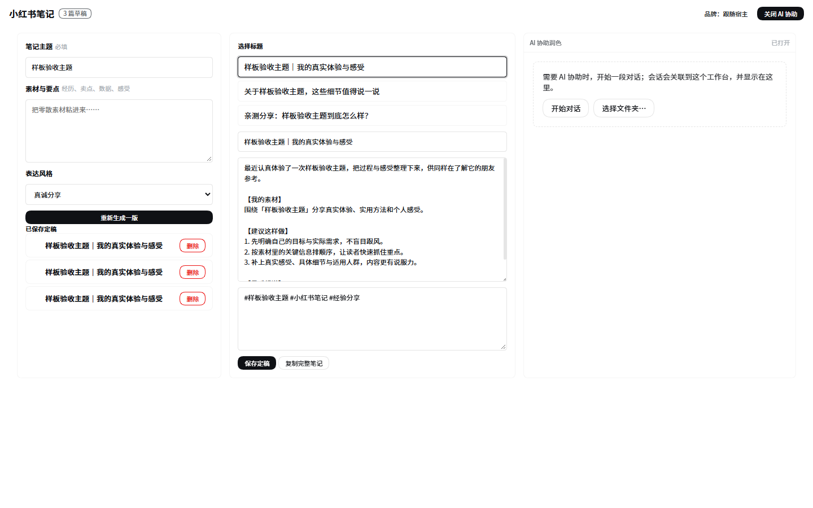
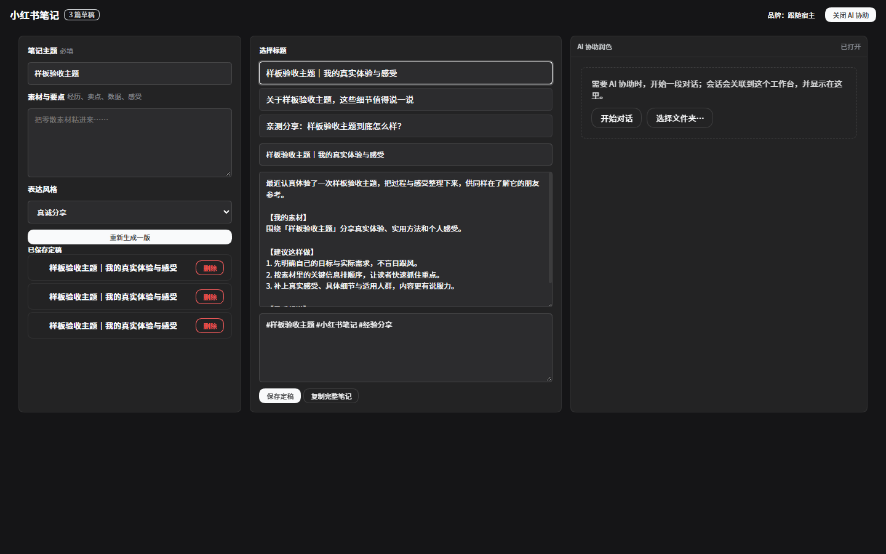

# 小红书笔记工作台 · 样板 demo

包：`dsh-plugins/vssaros-xhs-note`（`@vssaros/dsh-xhs-note@0.1.10`）
定位：**创作型工作台的参考实现**——把商城版 `sara2398/xiaohongshu-note-workbench` 的三个硬伤修掉，
同时保持「A 类挂载 + 共享层 + 容器查询」，当作以后做同类工作台时照抄的样板。

---

## 1. 长什么样（真机渲染）

| 明亮 | 暗色 |
|---|---|
|  |  |

两块图都是**沙箱真机渲染后导出的 DOM**（含宿主 CSS 变量与共享层样式），不是手画 mockup：

- 左栏：主题（必填）/ 素材要点 / 表达风格 / 生成按钮 / 已保存定稿（可载入、可删除）
- 中栏：4 个标题候选（点选即替换）+ 标题可编辑 + 正文 + 话题标签 + 保存定稿 / 复制完整笔记
- 右栏：AI 协助润色（宿主官方对话的**停靠节点**，`data-vssaros-xhs-conversation`）
- 顶栏：`小红书笔记` + 草稿计数 + 品牌切换（跟随宿主 / 小红书粉）+ AI 协助开关

**暗色证据**：根背景 `rgb(255,255,255) → rgb(21,21,23)`、正文色 `rgb(15,17,21) → rgb(249,250,251)`（探针实测），
所以「换主题不跟手」这个历史问题在这个样板里不存在。

---

## 2. 三个硬伤 → 三处代码

| 硬伤 | 商城版做法 | 本样板 | 代码 |
|---|---|---|---|
| **草稿只在 localStorage** | `localStorage[…drafts.v1]`，20 条上限，超出静默丢 | `<数据根>/xhs-note/drafts/<id>.json`：一稿一文件 + `tmp→rename` 原子写 + `rev` 乐观锁（冲突 **409**）+ 200 篇上限 + ISO 时间 | `lib/store.js` · `lib/index.js` |
| **暗色不跟随** | 自造 6 个变量 + 26 处裸色 | 颜色只走 `var(--dsw-alias-*, 兜底)`（自检断言 **0 行裸色**）；品牌收敛 `--wb-brand`，默认跟随宿主，`data-brand="xhs"` 才用粉；`@container` 860/560 两档 | `lib/client.xhs-note.js` |
| **AI 不知道你在写什么** | 打开对话不传草稿 | 点「AI 协助」→ 草稿组成指令 → **`vssaros-composer-prefill`** 事件 → chat-surface 落到 composer（**不自动发送**；输入机非 plain 或已有内容时不覆盖/改追加；回执 `{applied, reason}`） | `lib/prefill.js` + `vssaros-chat-surface/lib/client.js` |

旧数据不丢：`POST /x/xhs-note/api/migrate` 从 `localStorage` **一次性**迁移（标记写在数据根，幂等；localStorage 不删，留作保险）。

---

## 3. 怎么打开

装进任意 profile（`@vssaros/dsh-workbenchse` 宿主 + `@vssaros/dsh-chat-surface` + `@vssaros/dsh-foundation` 必须在组合里）：

1. 主页「工作台」卡片里的 **小红书笔记**（`WORKBENCH_MODULES` 已登记）；
2. 或启动器里 pin 一下（`DEFAULT_ITEMS` 已登记，route `/x/xhs-note/`）；
3. 直连页面：`/x/xhs-note/`（SSR 壳，没装客户端也能看到草稿清单）。

---

## 4. 怎么验（两条命令 + 一个探针）

```bash
# ① 包内自检：39 条（存储原子性 / 冲突 409 / 上限 / 迁移幂等 / HTTP 路由 / 无裸色 / 21 个 wb-* / 容器查询 / 入口无 chunk）
node dsh-plugins/vssaros-xhs-note/test/run-xhs-note-check.mjs

# ② 仓库守卫（本包已入 style 白名单）
node dsh-plugins/check-workbench-style.mjs
node dsh-plugins/check-workbench-catalog.mjs
node dsh-plugins/check-chat-surface-chunks.mjs
```

真机探针（沙箱，**13/13**）：`%TEMP%\wb-xhs-prep.mjs` 装包 → `VsSaros.exe %TEMP%\wb-xhs-probe`。
断言：注册表有 `vssaros/xhs-note` · 面板渲染（root/toolbar/生成按钮/对话停靠点/`#vssaros-wb-ui`）·
**切暗色颜色真的变** · 生成出标题 · **保存后 `/api/drafts` 读回且磁盘有 JSON** · 预填事件被认领（回执）· boot 无失败。

> 该探针顺带踩出两个真 bug，都已修并写进技能：①缺 `cordis.patch.yml` + `dsh.bundle.patch` ⇒ 插件**静默不激活**；
> ②描述符漏 `repository` ⇒ `Invalid workbench repository`（模块加载了但注册被拒）。

---

## 5. 想照抄时看哪几行

| 要做的事 | 看这里 |
|---|---|
| 注册与激活（三件套） | `cordis.patch.yml` · `package.json` 的 `dsh.bundle.patch` · `lib/client.js`（入口只装载）· `lib/client.xhs-note.js` 的 `install()` |
| 一稿一文件的原子存储 | `lib/store.js`（`writeAtomic` / `normalize` / `DraftConflictError`） |
| 令牌化 + 容器查询 + 锚点 | `lib/client.xhs-note.js` 的 `injectStyles()` |
| 把上下文塞进 composer | `lib/prefill.js` + `vssaros-composer-prefill` 监听 |
| 自检怎么写 | `test/run-xhs-note-check.mjs`（静态契约 + 存储行为 + HTTP 路由三层） |

---

## 6. 已知取舍（别误读）

1. **「生成」是本机模板**（4 风格 × 3 标题 + 固定正文骨架），**不走模型**——与商城版同口径；模型价值放在「润色」这一步。想全自动生成，把 `generate()` 换成 `POST /api/generate` 即可。
2. **预填按会话落笔**：沙箱里没有活动会话时回执是 `{applied:false, reason:'no-input'}`（通道通、落笔条件不满足）。要验"真的写进输入框"，需在有会话的实例里点一次「AI 协助」。
3. **品牌色默认跟随宿主**：「小红书粉」是显式切换项（`data-brand="xhs"`），不是默认皮肤——避免工作台在暗色主题里忽然变粉。
